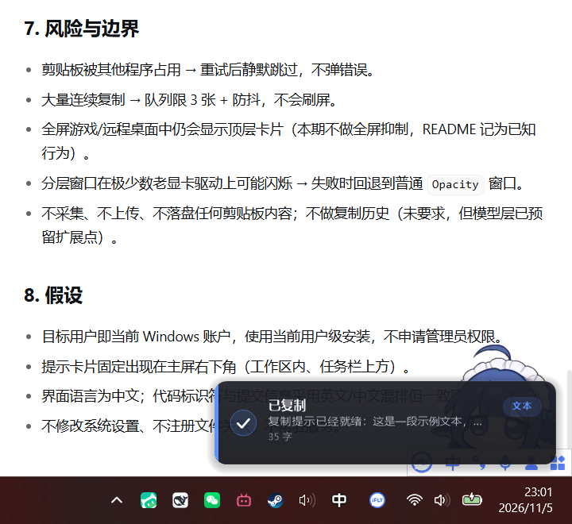
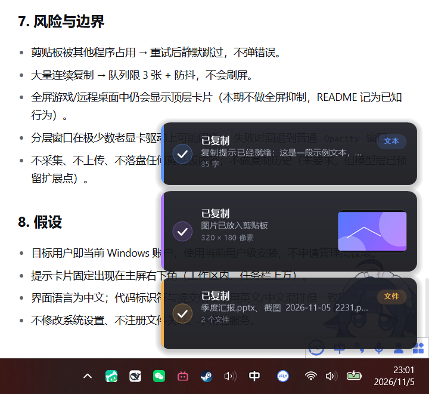

# CtrlCPulse

[](https://github.com/Lone-Jade/CtrlCPulse/actions/workflows/build.yml)
[](https://github.com/Lone-Jade/CtrlCPulse/releases/latest)
[](LICENSE)

按下 `Ctrl + C` 之后，屏幕右下角滑出一张自绘的半透明卡片，告诉你"刚刚复制了什么"：文字、图片还是文件。

不是系统气泡通知，也不是截图工具——它只是安静地待在托盘里，复制时给一个确认。



连续复制时卡片会向上堆叠，最新的一张在最下面：



## 它解决什么问题

`Ctrl + C` 是一个没有任何反馈的动作。按下去之后，你并不能确定：

- 焦点到底在哪个窗口上，复制的是不是我以为的那段内容；
- 复制的是纯文字，还是带格式的富文本；
- 截图/图片有没有真的进剪贴板；
- 在资源管理器里按 `Ctrl + C` 复制的那几个文件，是复制了还是剪切了。

CtrlCPulse 把"剪贴板里现在是什么"变成一眼可见的一行字。

## 功能

- **三种内容类型**：文字（含行数、字数预览）、图片（带等比缩略图）、文件（数量与总大小）。
- **自绘提示卡片**：32 位 ARGB 分层窗口，圆角 + 假阴影 + 逐像素透明，淡入淡出，不抢焦点、不进 Alt+Tab。
- **堆叠显示**：连续复制最多同时显示 3 张（可配置 1–5），旧卡片自动上移、超时淡出。
- **托盘常驻**：左键暂停/恢复提示，右键菜单可切换私密内容过滤、开机自启、预览三种样式。
- **开机自启**：安装时写入当前用户注册表 `Run` 项（失败则回退到启动文件夹快捷方式）。
- **隐私优先**：默认跳过带 `Clipboard Viewer Ignore` 标记的剪贴板内容（密码管理器常用该标记）；不联网、不落盘、不留剪贴板历史。
- **单实例**：重复启动不会出现第二个托盘图标，而是在已有实例上弹一张"已在运行"卡片。

## 环境要求

- Windows 10 / Windows 11（x64）
- .NET Framework 4.8（Windows 10 1903+ 与 Windows 11 自带）
- 构建需要：Visual Studio Build Tools 2022 或任意带 Roslyn `csc.exe` 的 VS 安装

不需要安装 .NET SDK，构建脚本直接调用 `csc.exe` 编译单文件 exe。

## 构建

```powershell
.\build.ps1          # 编译 dist\CtrlCPulse.exe
.\build.ps1 -Test    # 编译并运行 25 项自检
.\build.ps1 -Clean   # 清理 dist
```

首次构建会自动用 `tools\make-icon.ps1` 生成 `assets\app.ico`（9 种尺寸，全部由脚本绘制，不含第三方素材）。

## 安装 / 卸载

**从 Release 安装（不需要构建环境）**：到 [Releases](../../releases) 下载最新 `CtrlCPulse-v*.zip`，解压后运行：

```powershell
powershell -ExecutionPolicy Bypass -File .\install.ps1
```

**从源码安装**：

```powershell
.\build.ps1                # 先编译
.\install.ps1              # 安装 + 写开机自启 + 立即启动
.\install.ps1 -NoStart     # 只安装，不启动
.\install.ps1 -InstallDirectory 'D:\Tools\CtrlCPulse'   # 指定安装位置
.\uninstall.ps1            # 停止进程、删自启项、删程序目录
```

默认安装目录是**脚本所在目录的同级 `CtrlCPulse` 文件夹**，不占用系统盘；配置和日志也写在 exe 同目录，整个文件夹可以直接拷走。

安装后如果右下角看不到图标：Windows 11 默认把新应用的托盘图标收进 `^` 溢出区，把 CtrlCPulse 拖到常驻区域即可。

## 使用

| 操作 | 效果 |
| --- | --- |
| `Ctrl + C` 复制文字/图片/文件 | 右下角滑出对应卡片 |
| 托盘图标左键 | 暂停 / 恢复提示（图标提示文字同步变化） |
| 托盘图标右键 | 菜单：启用提示、忽略私密内容、开机自启、预览样式、关于、退出 |
| 鼠标悬停卡片 | 暂停该卡片的自动消失计时 |
| 单击卡片 | 立即关闭 |
| 再次运行 exe | 已有实例弹出"已在运行"，新进程退出 |

命令行参数：

```text
CtrlCPulse.exe            启动托盘（默认）
CtrlCPulse.exe --tray     同上，供开机自启使用
CtrlCPulse.exe --demo     演示模式：依次展示文字/图片/文件三种卡片后退出
CtrlCPulse.exe --reset    清空配置（下次启动重新显示欢迎卡片）
```

## 配置

配置保存在 **exe 同目录的 `settings.ini`**（便携模式，不写系统盘），纯文本，可直接编辑：

```ini
# CtrlCPulse 设置（修改后重启应用生效）
enabled=true
ignoreSecret=true
maxVisible=3
toastMilliseconds=2400
welcomed=true
```

| 键 | 含义 | 取值 |
| --- | --- | --- |
| `enabled` | 是否启用提示 | `true` / `false` |
| `ignoreSecret` | 跳过带"剪贴板查看器忽略"标记的私密内容 | `true` / `false` |
| `maxVisible` | 同时显示的最大卡片数 | 1–5 |
| `toastMilliseconds` | 每张卡片停留时间（毫秒） | 800–10000 |
| `welcomed` | 是否已显示过欢迎卡片 | `true` / `false` |

布尔值也接受 `1/0`、`yes/no`、`on/off`。

以 `#` 或 `;` 开头的整行是注释；文件缺失或损坏时按默认值启动，超出范围的值会被钳制。

异常日志写在同目录的 `error.log`（仅崩溃时产生）。

## 设计要点

想了解"为什么这么实现"，见 [docs/DESIGN.md](docs/DESIGN.md)：包括分层窗口的渲染管线、剪贴板监听的去重策略、DPI 缩放处理、以及那些看起来奇怪但必要的取舍。

## 测试

三套互补的验收，全部可重复执行：

```powershell
.\build.ps1 -Test                                  # 25 项纯逻辑自检
pwsh -STA -NoProfile -File .\tools\verify-clipboard.ps1   # 13 项端到端剪贴板/托盘验收
.\tools\verify-visual.ps1                          # 44 项像素级视觉验收
```

详见 [docs/TESTING.md](docs/TESTING.md)。

## 目录结构

```text
src/          应用源码（C# 7.3 / .NET Framework 4.8）
tests/        自检入口（与 src 一起编译成 CtrlCPulse.SelfTest.exe）
tools/        图标生成、视觉验收、功能验收脚本
assets/       图标与应用程序清单
docs/         设计说明、测试说明、验收截图
.github/      CI、发布工作流、issue / PR 模板
build.ps1     构建入口
install.ps1   安装
uninstall.ps1 卸载
```

## 参与贡献

欢迎提 issue 和 PR。开始之前请看 [CONTRIBUTING.md](CONTRIBUTING.md)（构建、代码结构、提交规范、发布流程）与 [CODE_OF_CONDUCT.md](CODE_OF_CONDUCT.md)。

安全问题请走 [SECURITY.md](SECURITY.md) 里的私密渠道，不要用公开 issue。

版本变化见 [CHANGELOG.md](CHANGELOG.md)。

## 已知限制

- 未做代码签名，首次运行可能出现 SmartScreen 提示（"更多信息 → 仍要运行"）。
- 只提示"剪贴板变化"，不记录历史；关闭应用后不会补发提示。
- 图片缩略图上限 184×116（96 DPI 基准），超大图片不放大、只等比缩小。
- 富文本（Word/Excel）按文字处理，保留纯文本预览，不渲染格式。
- 目前仅支持单显示器的主屏右下角定位（多显示器时会跟随主屏工作区）。
- 托盘菜单为中文；代码内注释亦为中文。

## 许可

[MIT](LICENSE)


